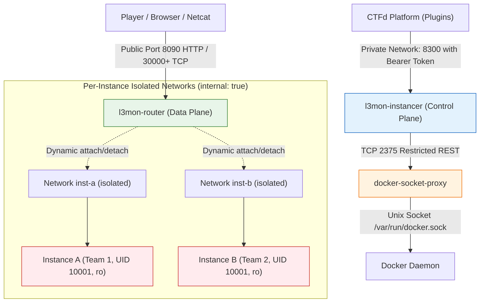

# Challenge Instancer Threat Model & Security Architecture

Milestone: M1 / M2 Draft  
Date: 17 October 2026  
Status: Active  

---

## 1. System Overview & Asset Inventory

The Challenge Instancer subsystem (`SP4`) manages the on-demand lifecycle of ephemeral, per-team challenge instances for web and pwn categories. Each challenge instance runs inside an isolated container with an injected dynamic flag derived deterministically from the master secret, team ID, and challenge ID via HMAC-SHA256.

### Protected Assets
1. **Host OS & Kernel Integrity**: Preventing container breakouts, kernel privilege escalation, and unauthorized host execution.
2. **Docker Control Plane**: Restricting access to the Docker daemon socket (`/var/run/docker.sock`), preventing arbitrary image execution, volume mounts, or host namespace access.
3. **Master Flag HMAC Secret (`FLAG_HMAC_SECRET`)**: Confidentiality of the root HMAC key used to compute per-team dynamic flags. Never exposed to challenge instances, the router, or players.
4. **Platform Databases & Caches (MariaDB / Redis)**: Protecting CTFd state, scoreboard integrity, session data, and user hashes from challenge instance reachability.
5. **Inter-Team Isolation**: Ensuring that Team A's challenge container cannot read, write, or reach Team B's challenge container, flag, network, or files.
6. **Host Cloud Metadata Service (`169.254.169.254`)**: Blocking all instance access to cloud provider metadata services (AWS/GCP/Azure) to prevent host identity token compromise.
7. **Host Compute & Network Capacity**: Protecting the challenge host against denial of service (DoS) through fork bombs, memory leaks, runaway disk usage, port exhaustion, and CPU starvation.

---

## 2. Threat Actors & Attack Profiles

1. **Malicious Player / Team (External Authenticated)**
   - Attempts to exploit web/pwn challenges to gain shell access inside the challenge container.
   - Probes network interfaces to pivot to other teams' instances, CTFd core services, or host metadata.
   - Attempts to exhaust host capacity via rapid instance allocation, renew spamming, or resource-heavy payloads.
   - Attempts to share flags or submit other teams' flags to manipulate the scoreboard.

2. **Compromised Instance Container (Internal Post-Exploitation)**
   - Executes arbitrary attacker code with user permissions inside the container.
   - Probes local file system for leaked secrets, tokens, or Docker sockets.
   - Attempts to establish outbound network connections (reverse shells, command-and-control, botnet DDoS).
   - Attempts kernel exploits, dirty copy-on-write, or cgroup escapes to break into the host namespace.

3. **Network Eavesdropper / MitM (Adjacent)**
   - Intercepts player traffic on public routes.
   - Attempts to abuse the instance router as an open HTTP proxy to access internal or arbitrary internet endpoints.

4. **Malicious / Buggy Challenge Author (Manifest Manipulation)**
   - Submits a challenge spec requiring root (`UID 0`), host bind mounts (`/var/run/docker.sock`), privileged mode, or host networking.

---

## 3. Trust Boundaries & Network Segmentation

### Trust Boundary Definitions
1. **Public Edge -> Router (`l3mon-router`)**:
   - Router accepts player traffic on dedicated ports (`8090` for HTTP, `30000-30200` for TCP).
   - Only forwards traffic matching authorized instance hostnames (`<inst_id>.<domain>`).
   - Does NOT have access to Docker socket, instancer write endpoints, CTFd database, or host filesystem.
2. **CTFd -> Instancer (`l3mon-instancer`)**:
   - Private communication over bridge network `l3mon_instancer`.
   - Authenticated via secret token `INSTANCER_TOKEN` in `Authorization: Bearer <token>`.
   - Instancer accepts only manifest challenge slugs (never arbitrary Docker images or commands).
3. **Instancer -> Docker Daemon via Socket Proxy (`docker-socket-proxy`)**:
   - Instancer does NOT mount `/var/run/docker.sock` directly.
   - Communicates through HAProxy socket proxy with explicit whitelist:
     - Enabled: `CONTAINERS=1`, `NETWORKS=1`, `POST=1`, `DELETE=1`, `INFO=1`, `VERSION=1`, `EVENTS=1`.
     - Disabled: `AUTH=0`, `BUILD=0`, `COMMIT=0`, `EXEC=0`, `IMAGES=0`, `VOLUMES=0`, `SECRETS=0`, `SWARM=0`.
4. **Instance -> Outside World**:
   - Dedicated internal bridge networks created with `internal: true`.
   - No default gateway route to the host, metadata service (`169.254.169.254`), or internet.
   - DNS resolution disabled or restricted.

---

## 4. Threat Matrix & Security Controls

| Threat ID | Threat / Attack Description | Attacker | Security Control(s) | Test / Verification |
|---|---|---|---|---|
| **TH-01** | Arbitrary Container Execution (RCE via Instancer API) | Malicious Player / Author | Instancer only accepts allow-listed `slug` from read-only manifest. `assert_safe()` enforces image pinning, non-root user, capability drops, and no-new-privileges. | `test_assert_safe_hostile_specs`, `test_manifest_validation` |
| **TH-02** | Docker Daemon Socket Hijacking | Compromised Instance | Instances have zero mounts to `/var/run/docker.sock`. Instancer itself communicates only through `docker-socket-proxy` where `EXEC`, `VOLUMES`, and `BUILD` are completely disabled. | `test_assert_safe_rejects_socket_mount`, `test_instances_isolation` |
| **TH-03** | Inter-Instance Network Pivoting | Compromised Instance | Every instance resides on a dedicated Docker bridge network created with `internal: true`. Containers cannot resolve or route packets to other instances. | `test_instances_isolation.py` |
| **TH-04** | Cloud Metadata Exfiltration (`169.254.169.254`) | Compromised Instance | Docker networks are flagged `internal: true` (no default gateway or outbound routing). Host iptables block metadata subnet from container bridges. | `test_instances_isolation.py` |
| **TH-05** | Master HMAC Secret Leakage | Compromised Instance | Instances only receive their individual derived team flag (`FLAG=L3m0n{...}`) in the container environment. The master `FLAG_HMAC_SECRET` is kept strictly within CTFd and instancer. | `test_instances_flag.py`, `test_instances_end_to_end_lifecycle` |
| **TH-06** | Open Proxy Abuse through Router | External Attacker | Router validates `Host` header against active registered route table. Unknown hostnames or missing subdomains are rejected immediately with `404 Not Found`. Relaying to arbitrary IPs is impossible. | `test_router_refuses_open_proxy`, `test_router_header_sanitization` |
| **TH-07** | Host Resource Exhaustion (DoS / Fork Bomb) | Malicious Team | Hard resource limits per container: `pids_limit` (128 max), `mem_limit` (256m max), `cpus` (1.0 max). Team quota: at most 3 live instances per team, 1 per challenge. | `test_quotas_enforced`, `test_assert_safe_resource_caps` |
| **TH-08** | Rapid Cycle / CPU Starvation DoS | Malicious Team | Mandatory 60-second cooldown enforced on stop/restart per team per challenge. Rapid restarts are rejected with HTTP `429 Too Many Requests`. | `test_cooldown_rejection`, `test_instances_end_to_end_lifecycle` |
| **TH-09** | Flag Sharing / Collusion | Malicious Teams | Dynamic flags are cryptographically unique per team (`HMAC-SHA256`). Submitting another team's flag fails validation and triggers the `l3mon_guard` evidence logger. | `test_instances_evidence.py`, `test_instances_end_to_end_lifecycle` |
| **TH-10** | Stale Container Accumulation (Resource Leak) | System Idle | Instancer background TTL reaper loop scans active instances every 5s and removes containers exceeding `expires_at`. Absolute 3-hour lifetime cap prevents indefinite renewals. | `test_reap_expired`, `test_renewal_constraints` |
| **TH-11** | Instancer Crash Desynchronization | Infrastructure Failure | Zero persistent state database in instancer. On boot, instancer reconciles all running containers and networks directly from Docker labels (`l3mon.instance`, etc.). Router dynamically recovers routes. | `test_reconcile_from_labels`, `test_instances_end_to_end_lifecycle` |
| **TH-12 (A1)** | Host Mount & Privilege Bypass via Modern Docker Fields | Malicious Author / Spec | `assert_safe()` validates `HostConfig.Mounts`, `Binds`, `PublishAllPorts`, and cgroups; enforces non-zero numeric UIDs (`re.fullmatch(r"[1-9][0-9]*")`) rejecting `00` or root strings. | `test_assert_safe.py` (22 tests) |
| **TH-13 (A2)** | Network Resource Depletion via Rejected Container Specs | Malicious Player / Author | In `manager.py`, on `assert_safe` failure or creation error, allocated networks and TCP ports are immediately cleaned up. | `test_instancer_core.py`, `test_instancer_concurrency.py` |
| **TH-14 (A3)** | Server Crash on Non-ASCII Flag Submission (TypeError DoS) | Malicious Player | `compare_digest` in `plugins/l3mon_instances/flag.py` encodes inputs to bytes before comparison. | `test_instances_flag.py` |
| **TH-15 (A4)** | Empty Token Match Bypass | Unauthenticated Caller | In `server.py`, empty `ROUTER_TOKEN` or `INSTANCER_TOKEN` never matches empty authorization headers, and byte comparison is enforced. | `test_api_endpoints.py` |
| **TH-16 (A5, R1)** | Router Memory Exhaustion & Request Smuggling DoS | External Hostile Client | Router bounds headers (< 100 lines, 8192 bytes max line), verifies `Content-Length <= 10MB` before reading, times out slow clients (10s), rejects conflicting `Content-Length` & `Transfer-Encoding`, rejects chunked requests, preserves multi-valued headers (`Set-Cookie`), streams backend responses in 64KB chunks with 20MB cap, and caps connections (50/instance, 1000 total). | `test_router.py` (18 tests), `test_router_survives_hostile_traffic` |
| **TH-17 (R2)** | Accidental Production Deployment with Dev Defaults | Operator Error | `INSTANCER_DEV` defaults to `0`. `compose.instancer-production.yml` hardcodes `INSTANCER_DEV: "0"`, mounts production manifest `/etc/l3mon/challenges.toml:ro` outside repository, binds router on `0.0.0.0`, and passes no dev tokens. | `test_instancer_compose.py` |
| **TH-18 (R4)** | Instancer Manager Lock Contention & Crash Leaks | High Concurrency / Crash | Quota check holds lock for microseconds with `starting` reservation, calling Docker outside the global lock. 15s Docker timeout. Startup reconcile cleans orphan networks left behind by interrupted creations. | `test_instancer_concurrency.py` (5 tests) |

---

## 5. Defense-in-Depth Container Hardening

Every challenge container started by the instancer is guaranteed to satisfy the following hardening baseline via `assert_safe()`:
1. `read_only: true`: Root filesystem is mounted read-only. Writable directories are limited to explicit, in-memory `tmpfs` mounts.
2. `cap_drop: [ALL]`: All Linux capabilities (`CAP_SYS_ADMIN`, `CAP_NET_ADMIN`, `CAP_SETUID`, etc.) are stripped.
3. `security_opt: ["no-new-privileges:true"]`: Prevents setuid binaries inside the container from acquiring elevated privileges.
4. `user: "10001:10001"`: Non-root execution. Containers declaring root or missing user directive are rejected at manifest load.
5. `network_mode: "none"` or isolated `internal: true` bridge network.
6. `mem_limit <= 1024m` (default 256m) and `pids_limit <= 256` (default 128).
7. Zero volume bind mounts to host files or directories.

---

## 6. Open Items & Roadmap for Milestone 2 & 3

- **Milestone 2**:
  - Implement full TCP router relaying and test port range binding security.
  - Dedicated automated isolation suite (`tests/integration/test_instances_isolation.py`) using fixture prober image.
  - Expand break-on-purpose test matrix to 30+ verified security assertions.
- **Milestone 3**:
  - Production host bootstrap script with host-level `DOCKER-USER` iptables rules dropping metadata IP `169.254.169.254`.
  - Multi-host capacity packing and remote agent mTLS verification.
